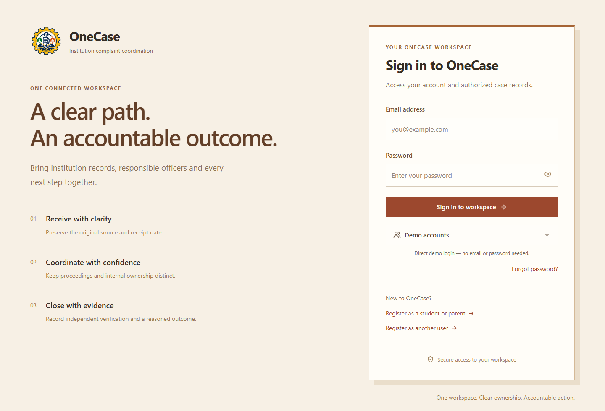
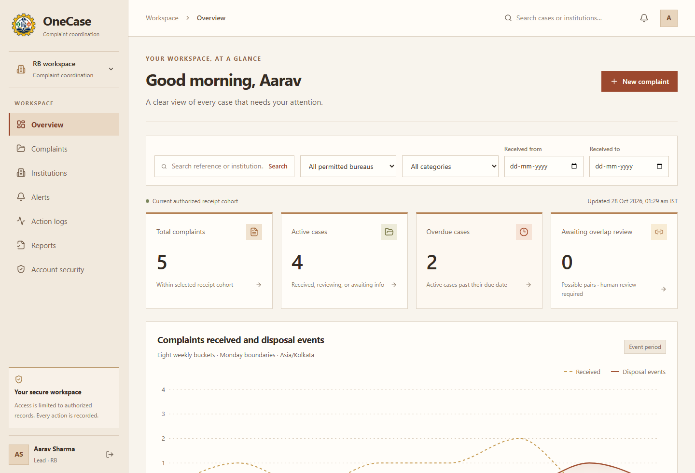
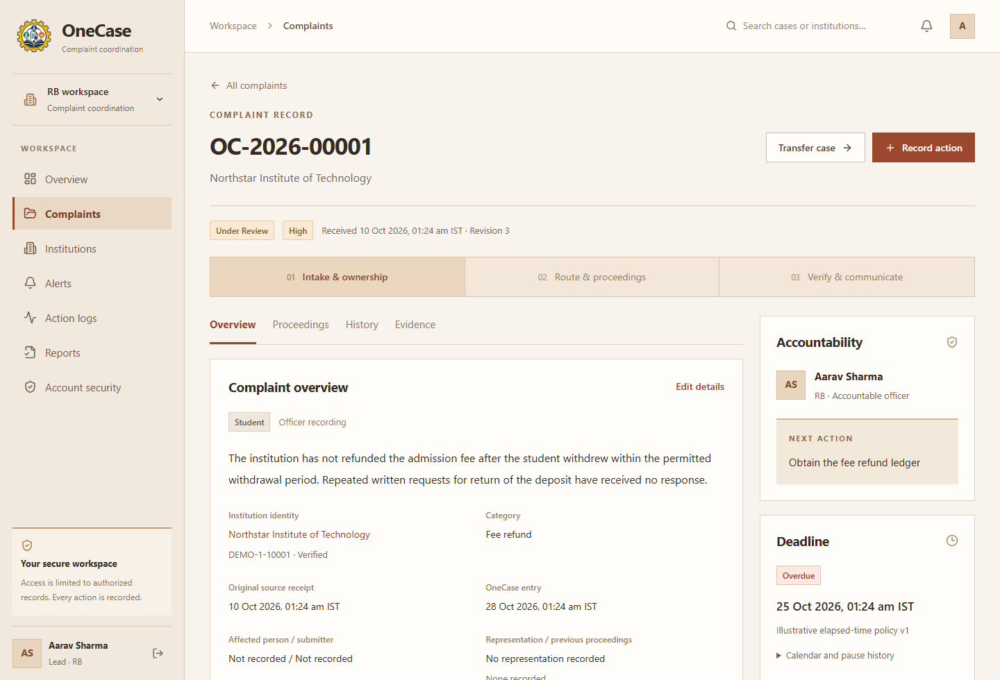
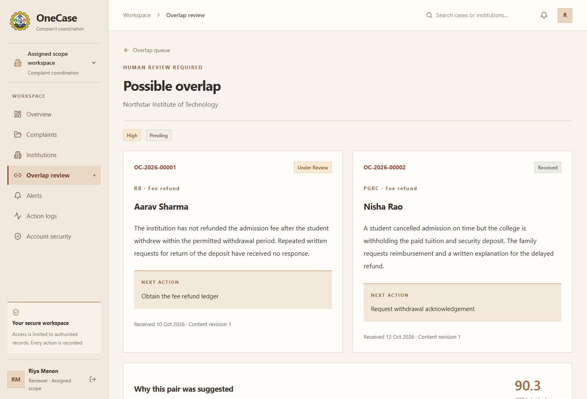
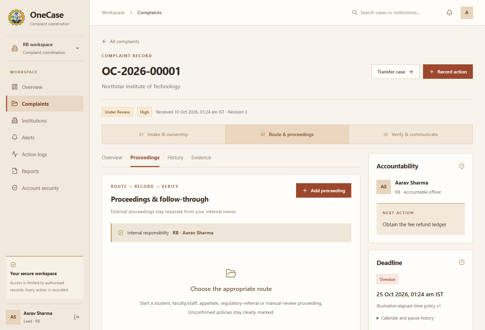
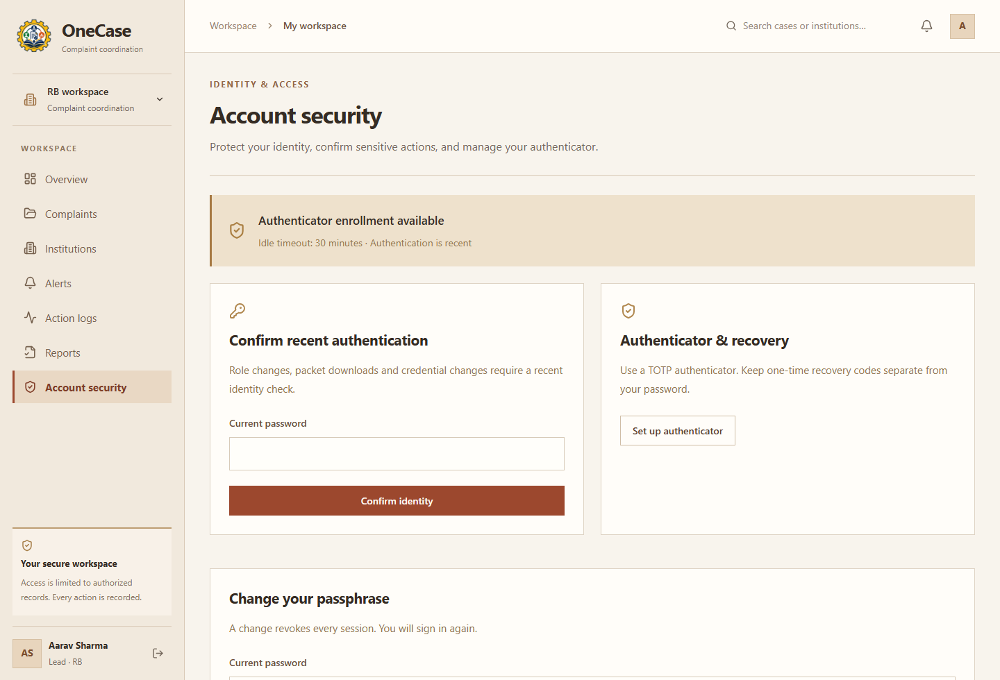

<p align="center">
  
</p>

# OneCase

**Team MODEST · SIH26264 · Institution complaint coordination**

OneCase brings complaint intake, accountable officers, related-case review, proceedings and evidence into one workspace. Stakeholders can submit and follow their complaints; approved staff coordinate the next action, retain the original record and document the outcome.

The website uses a warm ivory and terracotta theme, readable text and sharp controls. The selected gear emblem retains its original gold, navy, green and orange colours.

[Open the live app](https://sih-solution-kappa.vercel.app/) · [Screenshots](#screenshots) · [Local setup](#local-setup) · [Deployment](#deployment) · [Setup guides](#setup-guides)

[](https://github.com/jitendrachoudhary1401-hue/SIH-Solution/actions/workflows/ci.yml)

## What is implemented

| Area | Current behaviour |
| --- | --- |
| Public intake | Registration for students, parents, faculty, staff and other stakeholders; complaint source, institution, proof uploads and a personal timeline. Staff registrations request approval before receiving staff access. |
| Handling timeline | Initial faculty/grievance report, officer triage, lead and committee assessments, independent investigation, conditional auditor review, executive outcome and complainant appeal. Initial recommendations cannot dismiss cases. See [handling workflow and setup](docs/COMPLAINT_HANDLING_WORKFLOW.md). |
| Case coordination | Accountable owner, next action, original receipt date, recorded transfers and recipient acknowledgement. Authorized status changes support disposal and reopening. |
| Proceedings | Authority and route records, expiring appointments, notices/orders, milestone revisions, case packets, actual dispatch and acknowledgement records. |
| Compliance and closure | Evidence submission and independent verification are separate. Disposal requires outcome evidence and a communication record; a closure PDF freezes the recorded outcome. |
| Semantic overlap review | Local MiniLM embeddings retrieve candidates within the same verified institution; a cross-encoder reranks them. Assigned officers receive private alerts for their own case; a reviewer with access to both records the relationship decision. Original complaints remain separate. |
| Monitoring and reports | Scoped dashboard totals, ageing/overdue views, deadline and milestone reminders, notifications, action history and authorized CSV exports. |
| Administration | Staff approval, scoped permissions, role/appointment expiry, conflicts/recusals and manual institution verification with a recorded approval source. |
| Account security | Argon2 password hashing, opaque hashed sessions, CSRF checks, privileged MFA enrollment, recovery codes, recent-authentication gates and SendGrid password recovery. |
| Browser installation | Web app manifest and launcher icons; the install button opens the browser's native prompt when that browser offers installation. |

Case, document and field permissions are enforced in the backend. Aggregate monitoring access is separate from access to complaint content and private files.

**Current evidence setting:** the Render template explicitly sets `MALWARE_SCAN_ENABLED=false`. Files still pass signature, extension, size and bounded parser checks, but are labelled **Malware scan skipped** rather than clean. This reduces malware protection. Rejected evidence remains blocked. Re-enabling scanning blocks unscanned evidence until the worker checks it with a configured scanner.

## Screenshots

These screenshots show the current local website with synthetic demo data. Example counts and model scores illustrate the interface; they are not production impact or accuracy measurements.

### Sign in



### Officer dashboard



<details>
<summary><strong>Complaint record and ownership</strong></summary>

Original intake, responsible officer, next action, deadline and authorized case actions.



</details>

<details>
<summary><strong>Semantic overlap review</strong></summary>

Side-by-side complaints and local model signals support a human relationship decision. Scores are unvalidated triage signals, not probabilities.



</details>

<details>
<summary><strong>Proceedings and follow-through</strong></summary>

Proceeding routes and records remain distinct from the internal accountable owner. Preparing a case packet is separate from recording actual external dispatch.



</details>

<details>
<summary><strong>Account security</strong></summary>

Recent authentication, authenticator enrollment, recovery and password-management controls.



</details>

## Architecture

| Component | Implementation | Host / boundary |
| --- | --- | --- |
| Frontend | React, TypeScript, Vite, TanStack Query and Recharts | Vercel; deploy the `frontend` directory |
| API proxy | Server-side same-origin `/api` forwarding | Vercel function; backend credentials stay server-side |
| Backend API | Flask, SQLAlchemy, Pydantic, psycopg and Waitress | Render Web Service; deploy the `backend` directory |
| Background worker | Queued local inference, deadline/milestone monitoring and evidence validation | Separate Render Background Worker using `backend` |
| Database | PostgreSQL with Alembic migrations | Neon; pooled application connection and direct migration connection |
| Private evidence | S3-compatible `assets` bucket, randomized keys and SHA-256 checksums | Neon; downloads go through backend authorization |
| Rate limits | Shared Redis in production; memory storage for local development | Backend configuration |
| Password-reset email | SendGrid HTTPS Mail Send API | Backend configuration and a verified sender |

The request path is **browser → Vercel proxy → Render API**. Both API and worker use PostgreSQL and private storage. No separate AWS account is required by the storage adapter.

The matcher uses `sentence-transformers/all-MiniLM-L6-v2` and `cross-encoder/ms-marco-MiniLM-L6-v2` with pinned revisions. Models run locally in the worker; the application does not require a hosted LLM.

## Local setup

The following commands use PowerShell from the repository root. Use a development database and configure private environment files using the [setup guide](SETUP_GUIDE.md); preserve any existing `.env` or `.env.local` files.

```powershell
python -m venv .venv
.venv/Scripts/python.exe -m pip install -r backend/requirements.txt
npm ci
npm --prefix frontend ci
.venv/Scripts/python.exe backend/migrate.py
npm start
```

In a second terminal, run:

```powershell
npm run dev
```

Open the frontend at `http://127.0.0.1:5173`. Vite proxies `/api` to the backend at `http://127.0.0.1:5000`. The backend serves JSON APIs and private downloads; it does not serve frontend pages. Local SQLite is supported for development and synthetic checks; production requires PostgreSQL.

To enable matching and background monitoring locally:

```powershell
.venv/Scripts/python.exe -m pip install -r backend/requirements-models.txt
.venv/Scripts/python.exe backend/download_models.py
npm run worker
```

Provision accounts and approved access using the [backend guide](backend/README.md). Public role demos are opt-in through `DEMO_ACCOUNTS_ENABLED`; they are restricted to synthetic identities and their demonstration bureau. Known-password development seeds are rejected in production.

## Deployment

| Platform | Root directory | Essential setup |
| --- | --- | --- |
| Vercel | `frontend` | `VITE_API_BASE_URL=/api`, server-only `BACKEND_URL` pointing to Render, and `FRONTEND_PROXY_SECRET` |
| Render API | `backend` | Install `requirements.txt`, run `python migrate.py` before deployment, then start `python serve.py` |
| Render worker | `backend` | Install `requirements.txt` and `requirements-models.txt`, run `python download_models.py`, then start `python worker.py` |

Set the **same random `FRONTEND_PROXY_SECRET` of at least 32 characters on Vercel and Render**. Save environment changes and redeploy the affected services. Never give it a `VITE_` prefix.

For Render, use [the sanitized environment template](backend/.env.render.example). Production also requires PostgreSQL, complete private Neon storage settings, a valid MFA encryption key, a strong application secret, shared Redis and secure HTTPS cookies. Use `API_HOST=0.0.0.0`; Render supplies `PORT`. Remove Windows `MODEL_PATH` and `STORAGE_PATH` overrides so the deployed runtime defaults apply.

The committed [Render Blueprint](backend/render.yaml) defines the API and worker, with malware scanning explicitly bypassed. It does not create a ClamAV service. The worker uses a paid plan in this template. Manually created services need their environment and deployment settings entered separately.

The configured deployment branch is `dev`. Vercel must use it as the Production Branch; Render's Blueprint uses `autoDeployTrigger: checksPass`. Once the services and Git integrations are connected, pushes deploy through each platform. The GitHub workflow runs checks; it does not provision cloud services or enter secrets.

### Free-tier wake-up

- [`GET /api/wake`](https://sih-solution-kappa.vercel.app/api/wake) is public liveness: no database, Redis, authentication or model work. It returns `{"status":"awake","service":"onecase"}` without caching.
- `/api/health` checks database connectivity. Successful liveness alone does not establish that every dependency is ready.
- On initial load, the frontend shows **Waking up OneCase** and retries temporary startup failures for up to 90 seconds before its identity lookup. Writes are never replayed automatically.
- The wake flow runs when someone visits. Render Free can still sleep while idle; no scheduled keep-alive is configured.

## Verification

```powershell
npm run build
npm --prefix frontend run test:proxy
.venv/Scripts/python.exe -m pip install -r backend/requirements-test.txt
.venv/Scripts/python.exe -m pytest backend/tests -q
Set-Location frontend
npx playwright install chromium
npm run test:e2e
```

CI uses a disposable database and synthetic records. Browser checks cover registration, complaint intake, evidence/closure workflows, scoped access, MFA, native installation, cold-start recovery and outage/session revocation. The optional real-model browser scenario uses `E2E_MATCHING=1` after downloading the model bundle. Live Neon checks are opt-in and should use an isolated validation branch.

## Current limits

- Matching operates on complaint descriptions and needs verified institution identity, installed models and a running worker. Domain accuracy, multilingual quality and load/uptime targets have not been validated. AI does not decide complaints or merge them.
- Manual institution verification is implemented. Official registry integration, a staged bulk CSV importer and comprehensive issue-level matching remain future work; CSV export is available.
- Milestone policy and competent authority must be recorded. Administrative disposal does not automatically conclude linked external proceedings or certify legal compliance.
- Browser installation depends on browser support and eligibility. No offline access to private case data is promised.
- The current malware bypass is explicit. Storage policies, approved permissions, sender verification, backups and recovery procedures still need validation for the actual deployment.

## Setup guides

- [Complete setup and deployment](SETUP_GUIDE.md)
- [Frontend and Vercel](frontend/README.md)
- [Backend, Render and Neon](backend/README.md)
- [GitHub checks and deployment workflow](.github/README.md)
- [Neon setup and service verification](docs/NEON_SETUP.md)
- [Database schema and migrations](docs/DATABASE_SCHEMA.md)
- [Code audit, repairs and release checks](docs/CODE_AUDIT_AND_REPAIRS.md)

## Repository map

```text
frontend/src/       Website, case workflow, administration and account security
frontend/api/       Vercel server-side API proxy
frontend/tests/     Browser journeys with synthetic data
backend/app/        Authorization, case/proceeding APIs, storage, matching and jobs
backend/migrations/ Additive database migrations
backend/tests/      Backend and service checks
docs/screenshots/   README screenshots with synthetic demo data
docs/               Setup, schema and implementation audit
```

The implementation preserves original complaint records and uses human review for relationships and outcomes. The normalized identity/issue schema is additive; a schema row alone does not establish identity, prove an allegation or mean every roadmap feature is complete.
